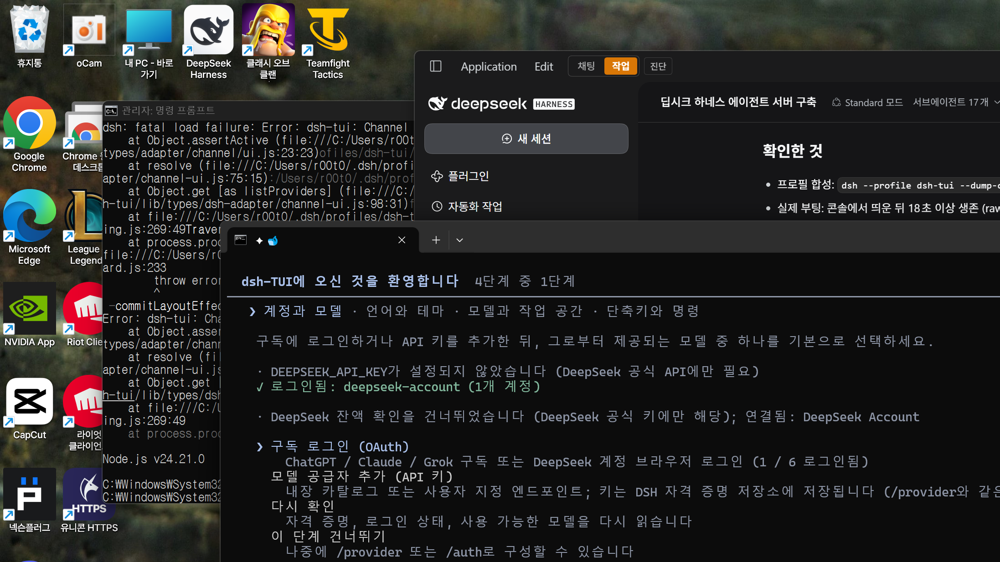

# dsh-TUI ?쒓뎅???⑥튂

[`@deepseek-harness-tui/dsh-tui`](https://www.npmjs.com/package/@deepseek-harness-tui/dsh-tui) ???곕???UI瑜??쒓뎅?대줈 諛붽씀??**鍮꾧났??* 濡쒖뺄 ?⑥튂?낅땲??

- ?€??踰꾩쟾: **0.19.0**
- 諛⑹떇: ?꾨줈?꾩뿉 ?ㅼ튂???⑦궎吏€??`lib/types` ??`*.ko.js` ?ъ쟾 紐⑤뱢??異붽??섍퀬, ?몄뼱 遺꾧린 肄붾뱶 10怨녹쓣 ?⑥튂
- 紐낅졊?는룰꼍濡쑣룻솚寃쎈??샕룸え?몃챸쨌?⑥텞?ㅻ뒗 ?먮Ц 洹몃?濡??〓땲??



## 而ㅻ쾭由ъ?

| ?곸뿭 | ?댁슜 | ?곹깭 |
|---|---|---|
| UI 臾몄옄??| i18n ?ъ쟾 **2,200??* (`i18n.ko.js`) | ??|
| `/tips` ?⑤꼸 | ??**146媛?* + 洹몃９ 5媛?| ??|
| `/settings` 紐⑸줉 | ?꾨뱶 58 쨌 ?듭뀡 58 쨌 洹몃９ 8 = **119媛?* | ??|
| ?ㅽ뵆?섏떆 ?쒓렇?쇱씤 | codex / claude 釉뚮옖??| ??|
| 荑좏룿 ?꾨＼?꾪듃 ?듯솕 | `?꾩븞` / `?щ윭` | ??|
| `/settings` ?뚰듃 臾몃떒 | 57媛?(?ъ빱?????곗륫 ?⑤꼸) | ???곸뼱 ?좎? |
| ?뚮윭洹몄씤 ?먯껜 ?ㅼ젙 ?뱀뀡 | ?대떦 ?뚮윭洹몄씤 ?몄뼱瑜??곕쫫 | ??|

## ?붽뎄 ?ы빆

- dsh-TUI **0.19.0** (`~/.dsh/profiles/dsh-tui` ???ㅼ튂?섏뼱 ?덉뼱????
- Node.js 18+

## ?곸슜

```powershell
git clone https://github.com/artists2/dsh-tui-korean.git
cd dsh-tui-korean
node apply.mjs
```

Windows?먯꽌??`reapply.cmd` 瑜??붾툝?대┃?대룄 ?⑸땲??

?⑦궎吏€ 寃쎈줈媛€ 湲곕낯媛?`~/.dsh/profiles/dsh-tui/node_modules/@deepseek-harness-tui/dsh-tui`)怨??ㅻⅤ硫?

```powershell
node apply.mjs --pkg "C:\path\to\@deepseek-harness-tui\dsh-tui"
# ?먮뒗
node apply.mjs --profile my-profile
# ?먮뒗
$env:DSH_TUI_PKG = "C:\path\to\dsh-tui"; node apply.mjs
```

?곸슜 ??TUI瑜??ъ떆?묓븯怨?`/lang` ??**?쒓뎅??* 瑜??좏깮?섏꽭?? ?좏깮媛믪? `~/.dsh-tui/lang.json` ???€?λ맗?덈떎.

## ?숈옉 諛⑹떇

`apply.mjs` 媛€ ?섎뒗 ??

1. `lib/types/i18n.ko.js`, `tips.ko.js`, `settings.ko.js`, `brand.ko.js` ?앹꽦
2. 10媛??뚯씪 ?⑥튂 (媛??뚯씪?€ 泥??ㅽ뻾 ??`*.ko-orig` 濡?諛깆뾽)

| ?뚯씪 | ?⑥튂 ?댁슜 |
|---|---|
| `i18n.js` | `LANGS` ??`ko` 異붽?, `isLang`/`PluralRules`/`t()`/`tOr()` 遺꾧린 |
| `components/LangPicker.js` | `/lang` 紐⑸줉???쒓뎅??|
| `screens/Chat.js` | `/lang` ?ㅻ쾭?덉씠 珥덇린 ?몃뜳??|
| `dsh-adapter/channel/command-completions.js` | `/lang` ?몄옄 ?먮룞?꾩꽦 |
| `components/TipsPanel.js` | `TIP_KO` 遺꾧린 |
| `components/LogoV2.js` | 釉뚮옖???쒓렇?쇱씤 ko |
| `components/StarPrompt.js` | ?듯솕 ?⑥쐞 |
| `screens/Settings.js` | `pick()` ??ko 遺꾧린 |
| `settings/definitions.js` | Language ?좏깮吏€??`?쒓뎅?? |
| `dsh-adapter/plugin.js` | config ?ㅽ궎留?`['zh','en','ko']` |

?ㅽ겕由쏀듃??**硫깅벑**?낅땲?? ?щ윭 踰??ㅽ뻾?대룄 `*.ko-orig` ?먮낯?먯꽌 ?ㅼ떆 ?⑥튂?섎?濡??덉쟾?⑸땲??

## TUI ?낅뜲?댄듃 ??
?낅뜲?댄듃??`lib/types` 瑜??듭㎏濡?援먯껜?섎?濡??⑥튂媛€ ?щ씪吏묐땲?? ??踰꾩쟾?먯꽌 ?ㅼ떆 ?ㅽ뻾?섏꽭??

```powershell
node apply.mjs
```

?댁쟾 踰꾩쟾??`*.ko-orig` 諛깆뾽?€ `.applied-version` ??蹂닿퀬 ?먮룞?쇰줈 ?먭린?⑸땲??
??踰꾩쟾???ㅺ? 異붽??섎㈃ 洹??ㅻ쭔 ?곸뼱濡??쒖떆?섍퀬(?대갚), ?섎㉧吏€???쒓뎅?대줈 ?좎??⑸땲??

## ?섎룎由ш린

```powershell
Get-ChildItem -Recurse "$env:USERPROFILE\.dsh\profiles\dsh-tui\node_modules\@deepseek-harness-tui\dsh-tui\lib\types" -Filter *.ko-orig |
  ForEach-Object { Copy-Item $_.FullName ($_.FullName -replace '\.ko-orig$','') -Force }
```

洹몃떎??`~/.dsh-tui/lang.json` ??吏€?곕㈃ 湲곕낯媛?以묎뎅???쇰줈 ?뚯븘媛묐땲??

## ?뚮젮吏??쒓퀎

- `/settings` ??**?뚰듃 臾몃떒 57媛쒕뒗 ?꾩쭅 ?곸뼱**?낅땲?? `settings.ko.json` ??`hintDescriptions.zh` 瑜??ㅻ줈 異붽??섎㈃ 諛섏쁺?⑸땲??
- ?뚮윭洹몄씤???먯껜 ?깅줉???ㅼ젙 ?뱀뀡 臾멸뎄??洹??뚮윭洹몄씤???몄뼱瑜??곕쫭?덈떎.
- ?섏쐞 ?먯씠?꾪듃/?꾧뎄媛€ 異쒕젰?섎뒗 蹂몃Ц?€ 紐⑤뜽???곕뒗 ?몄뼱?????⑥튂?€ 臾닿??⑸땲??
- TUI ?낅뜲?댄듃 ?뚮쭏???ъ쟻?⑹씠 ?꾩슂?⑸땲???먮룞 ???놁쓬).

## 湲곗뿬

踰덉뿭 ?섏젙?€ 媛?JSON ??怨좎튇 ??`node apply.mjs` 濡?諛섏쁺?섎㈃ ?⑸땲??

- `ko.json` ??i18n ?ъ쟾 (`?? 踰덉뿭`)
- `tips.ko.json` ??`{ "groups": {...}, "tips": { "tip-id": "踰덉뿭" } }`
- `settings.ko.json` ??**以묎뎅???먮Ц???ㅻ줈** ?곕뒗 ?쒓뎅??留ㅽ븨

## 硫댁콉

???€?μ냼??dsh-TUI 諛?DeepSeek?€ **臾닿???鍮꾧났????踰덉뿭**?낅땲?? ?⑥튂 ?ㅽ겕由쏀듃?€ 踰덉뿭 ?곗씠?곕뒗 ???€?묎텒?먯쓽 沅뚮━瑜?移⑦빐???섎룄媛€ ?놁쑝硫? 臾몄젣媛€ ??寃쎌슦 ?붿껌 ???€?μ냼瑜??대━寃좎뒿?덈떎.

## ?쇱씠?좎뒪

[MIT](LICENSE)
